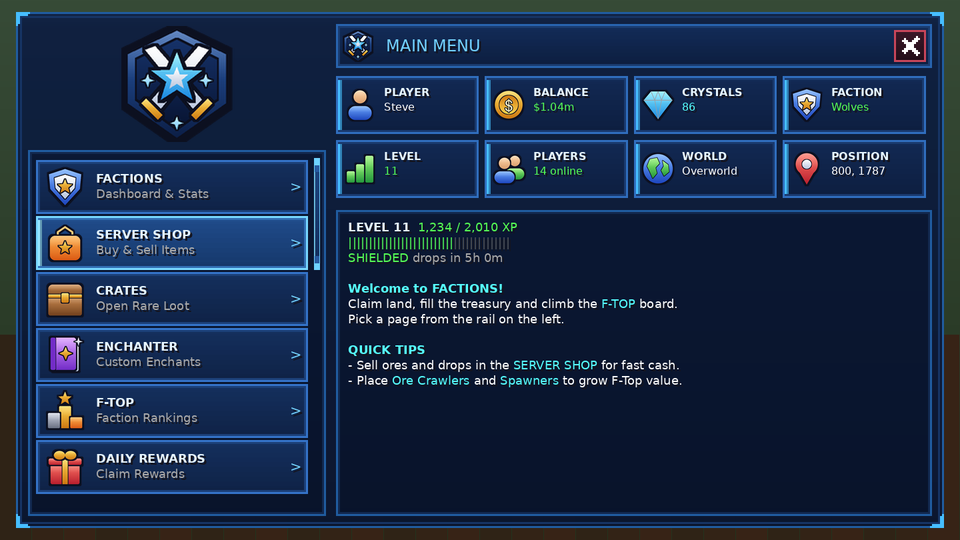
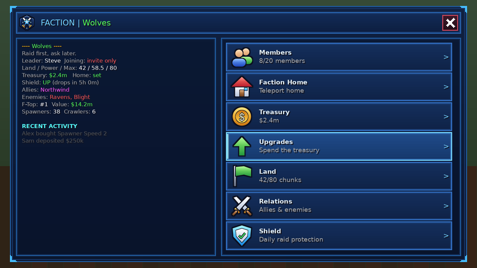
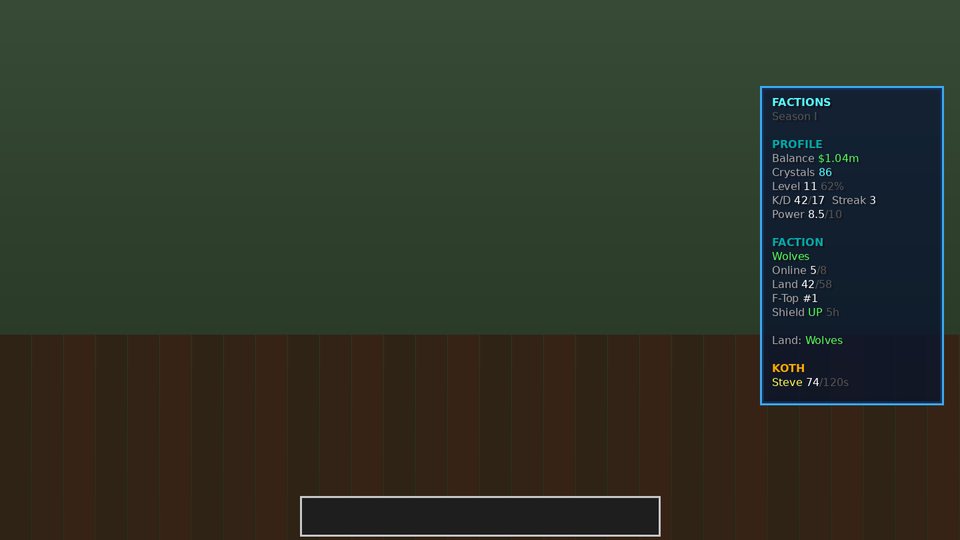

# Factions Core 2.0 (Minecraft Bedrock add-on)

The complete core for a factions server. It comes as three packs in one `.mcaddon`:
- **Factions Core:** all the gameplay.
- **Factions Core RP:** draws the styled menus, the sidebar, the items and the models.
- **Factions Core Chat:** shows ranks and factions in normal chat. It needs the **Beta APIs** experiment.

| | |
|---|---|
|  |  |

*Previews are drawn from the real textures and layout; in game the text uses the Minecraft font.*

## Install
1. Double-click `dist/FactionsCore_v<version>.mcaddon` to import all three packs.
   The number in the file name is the version. A higher number is a newer download.
2. Turn on **Factions Core** in your world's behavior packs. The resource pack and the chat pack are turned on with it automatically.
3. You need Minecraft Bedrock **1.26.60 or newer** for chat formatting, and the world needs **Beta APIs** turned on.
   Everything else works on 1.26.20 or newer without experiments. Without Beta APIs, normal chat simply stays vanilla.

**Updating:** just import the newer file. Every build has a new version number, so Minecraft replaces the old copy. To check which version a world is running, look at the Admin page in `/menu`, or for `Factions Core 2.1.x loaded` in the content log.

**On a dedicated server**, copy the pack folders from the `.mcaddon` into `behavior_packs` and `resource_packs`. Then list them in the world's `world_behavior_packs.json` and `world_resource_packs.json`, and turn on "require resource packs" so players get the menus.

New players get a **Server Menu** item, $500 and 2 Common Crate Keys. They can tap the item or type `/menu` to open everything.

## What's inside

### Factions, land and raiding
- **Factions:** four ranks (leader `**`, officer `*`, member `+`, recruit `-`), invites or open joining, and a faction colour.
  Each faction also has a treasury, an activity log, faction chat (`/fc`) and ally chat (`/fa`).
- **Power:** each player has −10 to 10 power. Dying costs 3 power, and being online gives 0.5 back each minute.
  A faction can hold one chunk for each point of its members' total power.
- **Land:**
  - Claims must touch your existing land and keep a 1-chunk gap from other factions.
  - Outsiders can't build, open containers or hurt animals on your land.
  - Allies can use your doors.
- **Raiding:**
  - TNT works on your land whenever your **shield** is down.
  - A faction with more land than power becomes **raidable**, and its enemies can **overclaim** its land.
  - Raid alerts tell you when your land is being blown up.
- **Shield:** the leader picks a daily window when your land can't be blown up or overclaimed. It is 6 hours long, and upgrades add more.
- **Relations:** ally, truce, neutral or enemy. Ally and truce need both sides to agree, and those factions can't hurt each other.
- **Upgrades** are bought with treasury money:

  | Upgrade | Effect |
  |---|---|
  | Recruitment | more member slots |
  | Land Grant | more claimable chunks |
  | Spawner Speed | faster spawners |
  | Crawler Speed | faster crawlers |
  | Miner's Haste | Haste on your land |
  | Swift Land | Speed on your land |
  | Shield Generator | longer shield |
  | Wisdom | more XP for members |
- **SafeZone and WarZone:** admin land. SafeZone has no PvP and no building. WarZone allows PvP but no building.

### Economy and progression
- **Money and Crystals.** Crystals are the rare currency. They come from kills, quests, levels, crates, crawlers and KOTH.
- **Levels:** you earn XP from mining ores, kills and quests.
  - Every level pays money, every 5 levels gives crystals, and every 10 levels gives a crate key.
  - You get one more home every 10 levels.
- **Server Shop:** buy and sell blocks, ores, crops, mob drops and raiding gear (TNT, redstone, gapples).
  It also sells spawners and ore crawlers. Use `/sell hand` or `/sell all` to sell quickly.
- **Crystal Shop:** crate keys, enchant books, genbuckets, chunk busters, sell wands, XP shards, power shards and mystery spawners.
- **Auction House:** list the item in your hand. Names, lore and custom enchants are kept.
  Unsold items return to your mailbox after 48 hours, and sales pay 5% tax.
- **Bank notes:** turn money into an item you can trade.
- **Daily rewards** on a 7-day streak. Day 7 gives a Legendary key.
- **Daily quests:** 3 random quests each day. Finishing all 3 gives an Epic key.
- **Bounties:** pay to put a price on someone's head. Whoever kills them collects it.
- **Kill streaks** are announced every 5 kills.
- **Combat tag:** you can't teleport for 15 seconds after a PvP hit. If you log out while tagged, you die when you come back.

### Custom items, enchants and rare loot
- **Crates** come in 5 rarities: Common, Rare, Epic, Legendary and Mythic.
  - Opening one plays a roll animation, and big wins are announced to the server.
  - Open them with a key anywhere, or on the crate blocks an admin places at spawn.
- **35 custom enchants** go on vanilla gear through **Enchant Books**. Each book has a success chance. Some examples:

  | Gear | Enchants |
  |---|---|
  | Weapons (on hit) | Lifesteal, Frostbite, Venom, Blaze, Blind, Withering, Executioner, Thunderstrike, Plunder, Obliterate |
  | Weapons (while held) | Swiftness (Speed), Rage (Strength) |
  | Weapons (mob grinding) | Greed, Scholar, Looter, Crystal Seeker, Mass Slayer |
  | Tools | Explosive (3x3 mining), Autosmelt, Telepathy, Treasure Hunter, Haste, Experience |
  | Armor | Overload, Regeneration, Dodge, Armored, Reflect, Berserk, Night Vision, Gears (speed), Leaper |
  | Anything | Soulbound (keep it when you die) |

  - Weapon enchants trigger by chance on melee hits. When one fires:
    - its name flashes on your action bar (for example **FROSTBITE!**)
    - a sound plays and particles appear on the target
    - **chat says what happened**, for example `[Enchant] Frostbite slowed Zombie.`
  - Players hit by your enchants get their own line, like `Steve's Frostbite slowed you.` Dodge and Reflect report in chat too.
  - Each enchant writes to chat at most once every 2 seconds. Turn the messages off in **Profile > Enchant Messages**.
  - A weapon with any Legendary or Mythic enchant is **Empowered** and gives Speed I while you hold it.
  - Held effects fade a couple of seconds after you switch items.
- **Legendary gear** drops from crates: Frostbite Blade, Inferno Cleaver, Stormbringer, The Reaper, Excavator 3000, Prospector's Pick and the 4-piece Titan set.
- **Classic factions tools:**
  - Cobble, Obsidian and Sand **Genbuckets** build walls straight down.
  - The **Chunk Buster** clears a whole chunk on your land.
  - The **Sell Wand** sells everything in a chest.
- **Shards and Mystery Spawners:** XP Shards, Power Shards, and Mystery Spawners (a random spawner, sometimes Iron Golem).

### Kits
Open **Kits** in `/menu` or type `/kit`. You pay each time you claim a kit, then wait for its cooldown.

| Kit | Price | Cooldown | Highlights |
|---|---|---|---|
| Starter | Free | 24h | stone tools, leather armour, food |
| Farmer | $10k | 12h | Efficiency hoe, seeds, crops, bone meal |
| Miner | $15k | 12h | Efficiency III + Haste pickaxe, torches, XP shards |
| Grinder | $60k | 24h | Grinder's Blade (Greed + Scholar), hoppers, chests |
| Builder | $20k | 12h | stone bricks, glass, logs, a stack of cobble genbuckets |
| Warrior | $40k | 12h | Protection II iron armour, Sharpness III diamond sword, bow, gapples |
| Raider | $100k | 24h | 64 TNT, redstone, dispensers, obsidian and sand genbuckets |
| Diamond | $250k | 48h | full enchanted diamond gear with Lifesteal, Autosmelt and Gears |
| Legend | 500 crystals | 72h | full netherite gear with Frostbite, Rage, Explosive, Overload, and a Legendary key |

Kits are defined at the top of `scripts/kits.js`, where you can change prices, cooldowns and contents.

### Bosses
**Boss Eggs only come from Mythic crates.** Use one on the ground to summon its boss:
- You can summon on your own land, in the wilderness or in the WarZone, but never in the SafeZone.
- Bosses have a health bar, special attacks, and get **enraged** below half health.
- When a boss dies, its loot drops on the ground and the top damage dealers are announced.

| Boss | Health | Attacks | Always drops | Exclusive loot (rolls) |
|---|---|---|---|---|
| Tier 1: Undead Warlord (giant zombie) | 500 | ground slam, summons zombies, rallies | 50 crystals, $250k note | Warlord's Cleaver, Warlord's Crown, Legendary key (1) |
| Tier 2: Bone Tyrant (giant wither skeleton) | 900 | wither aura, summons skeletons, slam | 100 crystals, $500k note | Tyrant's Edge, Bonewoven Greaves, Mythic book, Enderman spawner (1) |
| Tier 3: Infernal Golem (molten iron golem) | 1,500 | fire aura, slam, launches players | 200 crystals, $1m note | Molten Core, Magma Drill, Emerald Crawler, Iron Golem spawner (2) |
| Tier 4: Void Ravager (void ravager) | 2,500 | void pull, lightning, roar, slam | 500 crystals, $3m note | Void Reaver, Void Striders, Void Wings, Netherite Crawler, 2 Mythic keys (2) |

The boss gear can't be found anywhere else. It is the strongest in the game, for example:
- **Void Reaver:** a netherite sword with Obliterate, Thunderstrike III, Lifesteal III, Rage II and Soulbound.
- **Magma Drill:** a pickaxe with Explosive III, Autosmelt, Telepathy, Treasure Hunter III and Haste III.

The **Bosses** page in `/menu` lists every drop and its chance. Admins can give eggs with `/fadmin give bossegg_<1-4>`.

### Mob grinding
- **Spawner mobs are frozen:** they stay where they spawn and are put back if pushed, so grinders stay tidy.
  Turn this off with `freezeSpawnerMobs` in `config.js`.
- **Grinding enchants** go on swords and axes and work on every mob kill:

  | Enchant | Rarity | What it does |
  |---|---|---|
  | Greed I-III | Rare | $8 / $12 / $16 per mob killed |
  | Scholar I-III | Rare | extra level XP and XP orbs per kill |
  | Looter I-III | Epic | 20% / 40% / 60% chance to double a mob's drops |
  | Crystal Seeker I-II | Epic | 1.5% / 3% chance of a crystal per kill |
  | Mass Slayer I-III | Legendary | each kill takes 1-3 extra mobs off a stack, with their drops |
- Your action bar shows what each kill earned, like `+$24 | x2 drops | 2 kills`.
- **Grinding swords:**

  | Sword | Enchants | Where to get it |
  |---|---|---|
  | Grinder's Blade | Greed I, Scholar I | Rare crates, the Grinder kit, crystal shop (80) |
  | Golden Harvester | Greed II, Looter II, Crystal Seeker I, Mass Slayer I | Epic crates, crystal shop (350) |
  | Soul Collector | Greed III, Scholar III, Looter III, Crystal Seeker II, Mass Slayer III | Legendary crates |

### Spawners and Ore Crawlers
- **10 spawners**, from Pig up to Iron Golem.
  - Stack them on one block by using more of the same spawner on it. Sneak to add the whole stack.
  - They spawn **stacked mobs** (one mob showing "x56") that die one at a time.
  - Explosions drop each spawner in a stack half the time.
  - Their value counts toward **F-Top**.
- **Ore Crawlers** are little mining robots, in 6 tiers: Coal, Iron, Gold, Diamond, Emerald and Netherite.
  - They wander around your base digging ores into their storage.
  - Tap one to collect or sell its ores, or to buy upgrades: Speed, Fortune, Storage and Auto-Sell.
  - You can **evolve** a crawler into the next tier.
  - **Enemies can steal your crawlers if they take the land they're on.**

### Events
- **Envoy:** every 45 minutes, supply drops land in the WarZone, or near spawn if there is no WarZone. Each one holds loot from every rarity.
- **King of the Hill:** hold the hill alone for 2 minutes.
  The winner gets $250k, 50 crystals and a Legendary key, and their faction treasury gets $100k.

### Ranks and chat
Ranks are player tags, so the vanilla `/tag` command gives and removes them:

| Command | What it does |
|---|---|
| `/tag Steve add Owner` | built-in rank: **Owner**, **Admin**, **Mod**, **Helper**, **MVP** or **VIP** |
| `/tag Steve remove Owner` | takes it away |
| `/fadmin rank create Builder &d&lBUILDER` | makes your own rank (the name you type in `/tag`, then how it looks with `&` colour codes) |
| `/tag Steve add Builder` | gives your own rank |
| `/tag Steve add "rank:&6&lLegend"` | a one-off rank with no setup |
| `/fadmin rank delete Builder`, `/fadmin rank list` | manage your ranks |

- Ranks are **only a name in front of the player's name in chat**, like `[OWNER] [Wolves] Steve » hi`. They give no perks.
- A player shows **one rank at a time**. If they have several, the highest shows: Owner, Admin, Mod, Helper, MVP, VIP, then your custom ranks in the order you made them, then one-off `rank:` tags.
- **Chat modes:** `/f chat faction`, `/f chat ally` or `/f chat public` decides where your normal chat goes.
- **Moderation:** operators can `/mute <player> [minutes]` and `/unmute <player>`. Chat also blocks spam and repeated messages.
- The **Admin > Ranks** page in `/menu` can give ranks and create custom ones too.

**After a Minecraft update:** the chat pack is tied to one Minecraft version's beta API. If chat goes back to vanilla after an update, change `CHAT_BETA` in `tools/factions/build.py` to the new version and rebuild. The list of versions is in the comment next to it. The rest of the add-on keeps working in the meantime.

### Interface
- **Styled menus** for every screen, as in the previews above. Forms from other add-ons keep the normal vanilla look.
- **Sidebar:** your balance, crystals, level, K/D, power, faction, F-Top rank, shield timer and live event info. Turn it on or off with `/hud`.
- **Floating leaderboards:** admins can place them at spawn for F-Top, richest players, top killers, highest levels and best streaks.

## Commands
`/menu` opens everything. These shortcuts work too:

| Command | What it does |
|---|---|
| `/f` | your faction dashboard (`/f help` lists every faction command) |
| `/f create`, `join`, `leave`, `disband`, `invite`, `kick`, `promote`, `demote`, `leader` | faction basics |
| `/f claim [radius]`, `/f unclaim [all]`, `/f autoclaim`, `/f map` | land |
| `/f sethome`, `/f home`, `/f shield <hour>` | faction home and shield |
| `/f deposit`, `/f withdraw`, `/f upgrade <id>` | treasury and upgrades |
| `/f ally`, `truce`, `neutral`, `enemy` `<faction>` | relations |
| `/f info`, `list`, `who`, `power`, `top` | information |
| `/fc <msg>`, `/fa <msg>` | faction chat, ally chat (up to 8 words; put longer messages in quotes, or use `/f chat faction`) |
| `/shop`, `/sell hand\|all`, `/pay <player> <amount>`, `/bal [player]` | money |
| `/ah`, `/ah sell <price>` | auction house |
| `/crates`, `/daily`, `/kit [name]`, `/bounty <player> <amount>` | rewards |
| `/home [name]`, `/sethome [name]`, `/delhome [name]`, `/spawn`, `/wild`, `/warp [name]` | teleports |
| `/f chat public\|faction\|ally` | where your normal chat goes |
| `/mute <player> [minutes]`, `/unmute <player>` | operators: mute players |
| `/hud` | show or hide the sidebar |

If another add-on uses the same command name, add the prefix, for example `/factions:f` or `/factions:menu`.
For player names with spaces, put the name in quotes.
Amounts can be written like `5000`, `2.5k` or `1m`.

### Admin (operators)
The **Admin** page in `/menu` has buttons for most of this. `/fadmin help` lists every command.

| Command | What it does |
|---|---|
| `/fadmin bypass` | build and open anything anywhere |
| `/fadmin safezone [radius]`, `/fadmin warzone [radius]`, `/fadmin unclaim [radius]` | admin land |
| `/fadmin setspawn`, `/fadmin setwarp <name>`, `/fadmin delwarp <name>` | spawn and warps (for example `nether` and `end`) |
| `/fadmin koth set [radius]`, `/fadmin koth start\|stop` | King of the Hill |
| `/fadmin envoy` | drop supply crates now |
| `/fadmin hologram <ftop\|money\|kills\|level\|streak\|welcome\|remove>` | floating leaderboards |
| `/fadmin give <item> [amount]` | `key_<rarity>`, `book_<rarity>`, `spawner_<type>`, `crawler_<tier>`, `gear_<id>`, `crate_<rarity>`, `bossegg_<1-4>`, `crystal`, `genbucket`, `buster`, `wand`, `xpshard`, `power`, `mystery` |
| `/fadmin eco give\|take\|set <player> <amount>`, `/fadmin crystals <player> <amount>` | money and crystals |
| `/fadmin rank create <name> [look]`, `/fadmin rank delete <name>`, `/fadmin rank list` | custom ranks (give them with `/tag`) |
| `/fadmin disband <faction>`, `/fadmin setpower <player> <n>`, `/fadmin join <faction>` | faction tools |

### Suggested server setup
1. Build spawn, then run `/fadmin setspawn` and `/fadmin safezone 3`.
2. Place crate blocks at spawn: `/fadmin give crate_common` and the other rarities.
3. Add leaderboards with `/fadmin hologram ftop` and `/fadmin hologram money`.
4. Claim a WarZone ring for envoys with `/fadmin warzone 2`, then set the KOTH hill inside it with `/fadmin koth set 5`.
5. Set `nether` and `end` warps with `/fadmin setwarp`.

## Settings
- Gameplay numbers are at the top of `packs/FactionsCore_BP/scripts/config.js`. This includes the server name on the menus and sidebar, power, claim and explosion rules, shield hours, kill rewards, auction tax, spawner speed and event timers.
- Shop prices are in `scripts/shop.js`, crate loot in `scripts/crates.js`, and enchants in `scripts/enchants.js`.

After changing anything, run `python3 tools/build_factions.py` (needs Pillow) to rebuild both packs and `dist/FactionsCore_v<version>.mcaddon`.

## For developers
- `packs/FactionsCore_BP/scripts/` holds the hand-written game logic, on `@minecraft/server` 2.7.0 and `@minecraft/server-ui` 2.0.0.
- `tools/factions/` generates everything else:
  - `build.py`: item, block and entity JSON, and packaging
  - `art.py` and `icons.py`: all textures and icons
  - `ui.py`: the JSON UI
  - `preview.py`: the pictures above
- `sh tools/factions/test/run.sh` plays a scripted game session against a fake Minecraft API and checks 118 behaviours. Run it before shipping changes.
- Styled menus are chosen by an invisible marker at the start of the form title (see `scripts/ui.js`). The sidebar reads titles that start with `fchud:`.
